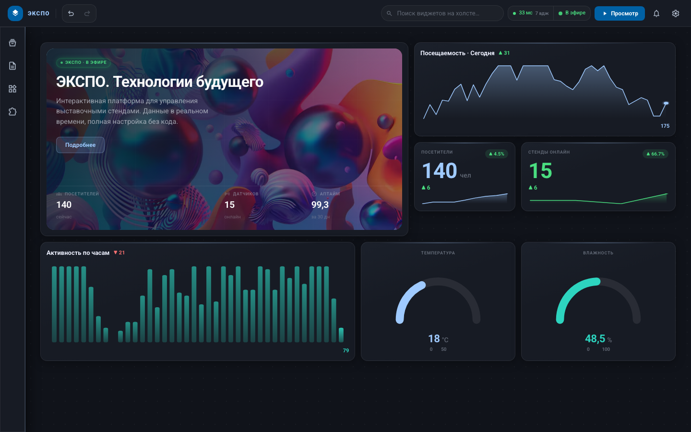
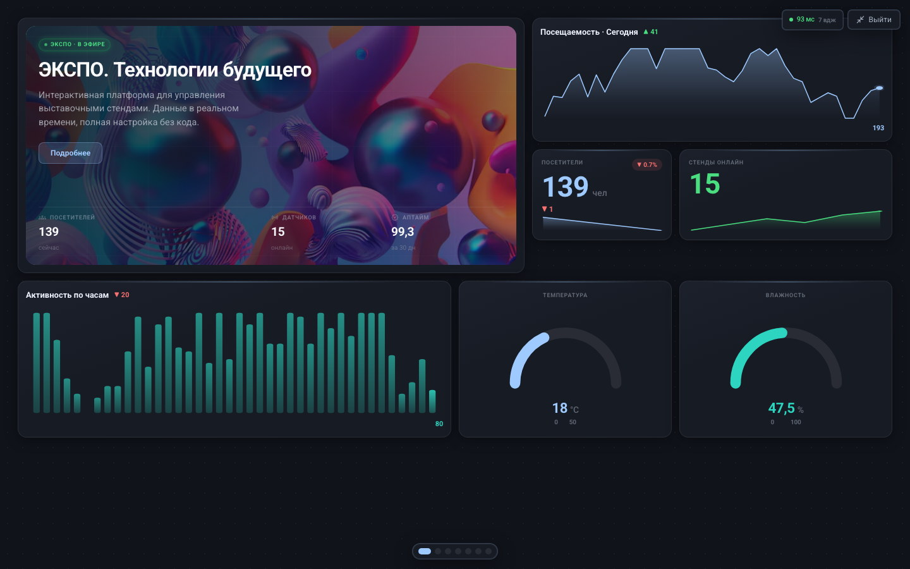
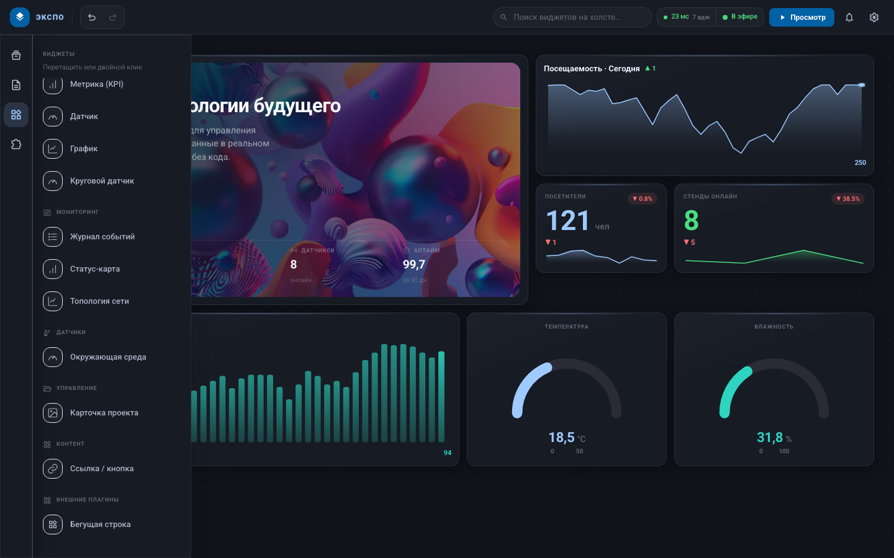

# Конструктор интерактивных панелей для выставок

No-code / low-code платформа для сборки выставочного экрана перетаскиванием виджетов.
Интерфейс описывается **JSON-схемой** и рендерится динамически (**schema-driven UI**) через
**плагинную архитектуру** виджетов. Данные датчиков приходят в реальном времени по **WebSocket**.

## Скриншоты

| Редактор | Kiosk-режим | Палитра виджетов |
|---|---|---|
|  |  |  |

## Стек

React 18 · Vite · TailwindCSS · react-grid-layout · HTML5 Drag and Drop API · нативные WebSocket
(мок-сервер на `ws`). Без форка тяжёлых монолитов — лёгкое ядро ради KPI рендера 20+ виджетов < 300 мс.

## Запуск

```bash
npm install
npm run dev      # поднимает мок WS-сервер (порт 8081) + Vite (порт 5173)
```

Открыть http://localhost:5173. Kiosk-режим: http://localhost:5173/?mode=kiosk (или кнопка «Просмотр» в TopNav).

Прочие команды: `npm run server` (только WS-сервер), `npm run build`, `npm run preview`.

## Архитектура (3 этапа ТЗ)

### 1. Движок конфигурации — `src/core/`
- `schema.js` — формат JSON-схемы панели, операции, нормализация, демо-панель из 23 виджетов.
- `registry.js` — плагинный реестр (`register` / `get` / `list`). Виджет = плагин.
- `storage.js` — сохранение/загрузка (localStorage + экспорт/импорт JSON-файла).

Формат схемы:
```json
{
  "version": 1,
  "title": "Выставочный стенд",
  "grid": { "cols": 12, "rowHeight": 40, "gap": 12 },
  "widgets": [
    { "id": "w_1", "type": "gauge", "layout": { "x": 0, "y": 0, "w": 3, "h": 4 },
      "props": { "label": "Температура", "min": 0, "max": 40 },
      "dataSource": { "channel": "sensor.temp" } }
  ]
}
```
Layout живёт только в схеме (единый источник правды) — отсюда сохранение JSON без багов вёрстки.

### 2. Модуль интеграции (WebSocket) — `src/core/`
- `WebSocketManager.js` — одно соединение, pub/sub по каналам, авто-reconnect, буфер последнего значения.
- `useRealtime.js` — хук подписки виджета на `dataSource.channel` (+ история для графиков).
- `server/ws-server.js` — мок-сервер: 32 канала (датчики/метрики/графики) с генераторами во времени.

### 3. Визуальный редактор — `src/components/`
- `Editor.jsx` — каркас (TopNav + LeftPanel + Canvas + PropertiesPanel).
- `TopNav.jsx` — верхняя панель: поиск виджетов, PerfBadge, WS-статус, кнопка «Просмотр» (Kiosk), Notifications, SettingsMenu.
- `LeftPanel.jsx` — источники виджетов, **HTML5 Drag&Drop**; здесь же загрузка внешнего плагина по URL.
- `Canvas.jsx` — рабочее поле **Grid Layout** (`react-grid-layout`): drop из палитры, перемещение, ресайз.
- `WidgetFrame.jsx` — schema-driven обёртка: lookup в реестре + error-boundary на битый плагин.
- `PropertiesPanel.jsx` — авто-форма свойств из `plugin.configSchema`.
- `PerfBadge.jsx` — живой замер времени рендера панели (KPI < 300 мс).
- `LayoutPicker.jsx` — выбор шаблона страницы (`src/core/layouts.js`).
- `Notifications.jsx` — пороговые оповещения + push через ntfy.sh.
- `Dialog.jsx` — универсальное модальное окно подтверждения/действия.

### Kiosk / signage — `KioskView.jsx`
Та же схема, тот же `Canvas`/`WidgetFrame`, но read-only, на весь экран (Fullscreen API), без редактора.

## Как добавить свой виджет

Создать плагин и зарегистрировать:
```jsx
import { register } from './core/registry'
register({
  type: 'my-widget',
  name: 'Мой виджет',
  group: 'Контент',
  defaultSize: { w: 3, h: 3 },
  defaultProps: { title: 'Привет' },
  realtime: false,                       // true → появится привязка к каналу
  configSchema: [{ key: 'title', label: 'Заголовок', type: 'text' }],
  Component: ({ props, dataSource }) => <div>{props.title}</div>
})
```
Виджет сразу появится в палитре. Внешний плагин (без пересборки ядра) — см. `public/plugins/sample-plugin.js`
и поле «Внешний плагин (URL)» в палитре.

## Десктоп-релизы (Electron)

Приложение оборачивается в Electron: единый `.exe`/`.dmg`/`.AppImage`+`.deb`, мок WS-сервер
запускается внутри процесса — конечному пользователю не нужны Node/npm.

```bash
npm run electron:dev       # dev-цикл: WS-сервер + Vite + Electron-окно на localhost
npm run electron:preview   # прод-сборка фронта + запуск Electron локально
npm run dist:electron      # сборка инсталлятора для текущей ОС (electron-builder)
```

Релиз для всех трёх ОС собирается в GitHub Actions (`.github/workflows/release.yml`):
запушить тег `vX.Y.Z` — воркфлоу соберёт win/mac/linux и опубликует артефакты в GitHub Release.
mac-сборка не подписана (нет Developer ID сертификата) — Gatekeeper покажет предупреждение при первом запуске.

## KPI

- Рендер панели из 20+ виджетов < 300 мс — индикатор `PerfBadge` в тулбаре (демо-панель: 23 виджета).
- Сохранение JSON-конфига без багов вёрстки — Save/Load/Export/Import, layout только в схеме.
